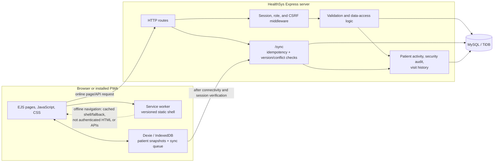

# HealthSys

HealthSys is an Express/EJS patient-management application backed by a MySQL-compatible database (including TiDB). It provides authenticated patient and staff workflows, encounter and appointment records, reporting, audit/recovery tools, and an installable progressive web app (PWA).

## Features and implementation status

**Implemented in the current codebase**

- Role-checked staff sign-in, session versioning, CSRF protection, and administrator-managed staff accounts.
- Patient search, combined filters, sorting, server-side pagination, patient profiles, soft deletion/restoration, emergency contacts, allergies, medical history, and medications.
- Visit/encounter history with consultation details, treatment plans, vital signs, author attribution, and visit activity history.
- Appointment management, administrator reports, CSV export/import, server backup/restore, and security audit views.
- A static-shell PWA and a device-local patient workspace. Previously cached patient data can be read offline; supported patient create/edit/delete operations are queued locally and require a fresh online session before server synchronization.
- Optimistic version checks, stable operation IDs, retries, and conflict review for queued patient changes.

**Partial or environment-dependent**

- Offline Dashboard and Reports show clearly labeled device-local or stale snapshots, not complete server results. Offline Staff and Data Recovery pages are informational; server mutations, CSV/backup operations, appointment management, visits, and encounter history require connectivity.
- Offline records are held in browser storage, which this application does not encrypt. Do not use a shared or unmanaged device for clinical data.
- Integration/performance tests and a manual PWA demonstration require a separate disposable database and browser/device. Automated tests do not prove production deployment, multi-instance behavior, or backup restoration.

**Not provided:** offline appointment/visit editing, automatic merging of conflicting clinical edits, encryption of browser-local records, or automatic schema rollback.

## Technology and architecture

- Node.js, Express 5, EJS, browser JavaScript/CSS, `mysql2`, and MySQL/TiDB.
- Dexie/IndexedDB stores device-local patient snapshots and the account-scoped sync queue. Cache Storage is limited to the static app shell and offline fallback pages.
- The application uses server-side sessions and SQL-backed route handlers. `/sync` authenticates operations, applies version and idempotency checks, and acknowledges each successful operation before the browser removes it from the queue.



**Online request flow:** the browser requests an authenticated page or API; Express resolves the session and role, validates the request, and reads or changes MySQL/TiDB. Mutations are audited as implemented by the route.

**Offline-to-online flow:** a previously authorized browser opens the cached offline patient workspace and its local IndexedDB data. Supported changes are persisted locally with stable operation IDs and displayed as pending. Once online, the app verifies the server session and sends queued operations to `/sync`. The server applies or rejects each operation; only matching successful/idempotent acknowledgements remove queue entries. Stale edits remain for explicit review.

## Prerequisites

- Node.js **24.x** and npm **11.x** are the runtime versions available and used for verification in this environment. Other Node/npm versions have not been verified here.
- A MySQL-compatible database with InnoDB, transactions, and the SQL features used by the migrations. The app is configured to use a TLS CA at `server/cert/isrgrootx1.pem`; use a trusted CA appropriate to the database endpoint.
- PowerShell on Windows for the commands below. A separate trusted HTTPS-terminating proxy is required for production.

The configured test endpoint reported TiDB v8.5.3 serverless / MySQL compatibility version 8.0.11 during this delivery's integration run. Standalone MySQL versions and other TiDB releases have not been verified here; check the exact service/version before deployment.

## Windows / PowerShell installation

1. Clone or copy the repository, open PowerShell in its root, and install the lockfile dependencies:

   ```powershell
   npm ci
   ```

2. Create a local environment file and replace every placeholder. Use a long, random `SESSION_SECRET`; never commit `.env`.

   ```powershell
   Copy-Item .env.example .env
   ```

3. Provision a dedicated database and application user using your database administrator's approved process. For a new development/demo database, run [`database/base-schema.sql`](./database/base-schema.sql) **in that selected database**. For example, after `.env` is configured and with the MySQL CLI installed:

   ```powershell
   mysql --host $env:DB_HOST --port $env:DB_PORT --user $env:DB_USER --password --database $env:DB_NAME --ssl-mode VERIFY_IDENTITY --ssl-ca .\server\cert\isrgrootx1.pem --execute 'source .\database\base-schema.sql'
   ```

   The CLI prompts for the database password. The SQL creates only the legacy-compatible base `patients` and `users` tables expected by the additive migrations; it does not create a database, user, or password. Do not run it as a substitute for reviewing an existing deployment schema.

   `server/setup_db.js` is a legacy local helper that creates only a minimal patients table through `LOCAL_DB_*`; it is not the complete application bootstrap and is not the recommended setup path.

4. Set `.env`'s `DB_HOST`, `DB_PORT`, `DB_USER`, `DB_PASSWORD`, and `DB_NAME` to the chosen database. `server/db.js` also needs the CA file at `server/cert/isrgrootx1.pem`.
5. Apply the ordered, additive migration set:

   ```powershell
   npm run migrate
   ```

   Migration order is `001_patient_management`, `002_staff_security`, `003_security_audit`, `004_sync_idempotency`, `005_sync_logs`, `006_appointments`, `007_patient_encounters`, and `008_patient_query_indexes`. The runner records successful IDs in `schema_migrations`. Take a database snapshot before production migrations: MySQL DDL may commit outside a transaction, and this project does not provide down migrations.

6. Start locally:

   ```powershell
   node server/generate_dev_cert.js
   npm start
   ```

   The development certificate command creates ignored, self-signed localhost key/certificate files and refuses to overwrite existing files. The server listens on HTTP `http://localhost:3000` and HTTPS `https://localhost:3443` by default. On localhost, HTTP is a secure context for service-worker development; the browser may show a self-signed-certificate warning on HTTPS.

7. Open `http://localhost:3000/login`. To create the first administrator, set a strong one-time `INITIAL_ADMIN_PASSWORD` in the server environment and run `node createAdmin.js`; the account username is `admin`. Remove the temporary password from the environment afterward.

For production, set `NODE_ENV=production`, configure `HTTPS_REDIRECT_ORIGIN` and the exact trusted `TRUST_PROXY` value, and terminate TLS at a trusted proxy. The development certificate listener is not used in production.

## Environment variables

See [`.env.example`](./.env.example) for names and non-secret placeholders. Required application values are `SESSION_SECRET`, `DB_HOST`, `DB_PORT`, `DB_USER`, `DB_PASSWORD`, and `DB_NAME`. Production additionally needs `HTTPS_REDIRECT_ORIGIN`. `TRUST_PROXY` should be set only to the actual trusted proxy hop count/address configuration.

`INITIAL_ADMIN_PASSWORD`, `RESTORE_ADMIN_PASSWORD`, and `DEBUG_USER_PASSWORD` are operation-specific secrets; set them only for the corresponding operation and remove them afterward. `LOCAL_DB_*` is consumed by the legacy local setup helper, not by the application pool. Destructive integration tests and demo seeding each have separate explicit opt-ins.

## Tests

Unit tests do not require database writes:

```powershell
npm test
npm run lint
npm run format:check
```

Integration tests are destructive. Use only a confirmed disposable database named exactly `healthsys_test`; never point these commands at `project` or a shared database. The integration guard also requires the explicit opt-in:

```powershell
$env:DB_NAME = 'healthsys_test'
$env:ALLOW_DESTRUCTIVE_INTEGRATION_TESTS = 'true'
npm run test:integration
npm run test:performance
Remove-Item Env:ALLOW_DESTRUCTIVE_INTEGRATION_TESTS
Remove-Item Env:DB_NAME
```

The performance test creates synthetic patients/visits, checks paginated/filter queries and query plans, then removes its generated rows. Do not claim its response timings represent production: database/network conditions affect them. `npm run test:release` runs unit and guarded integration tests, but does not include `test:performance`. Run tests only after reviewing the test database contents and confirming it is disposable.

## Synthetic demo data

Use a separate, migrated `healthsys_demo` database, never the application `project` database. Create an application configuration for this database and complete the base-schema/migration steps above. The seed creates 24 fictional patients, two synthetic visits and vital readings per patient, and demo administrator/staff accounts. Every patient/encounter is explicitly marked synthetic. Passwords are supplied at runtime; no demo password is embedded in source.

In PowerShell, set the database and opt-in for this process, then enter strong demo-only passwords without echoing them:

```powershell
$env:DB_NAME = 'healthsys_demo'
$env:ALLOW_DEMO_SEED = 'true'
$secureAdmin = Read-Host 'Demo administrator password' -AsSecureString
$env:DEMO_ADMIN_PASSWORD = [System.Net.NetworkCredential]::new('', $secureAdmin).Password
$secureStaff = Read-Host 'Demo staff password' -AsSecureString
$env:DEMO_STAFF_PASSWORD = [System.Net.NetworkCredential]::new('', $secureStaff).Password
npm run seed:demo -- --seed
Remove-Item Env:DEMO_ADMIN_PASSWORD, Env:DEMO_STAFF_PASSWORD, Env:ALLOW_DEMO_SEED, Env:DB_NAME
```

Seed re-runs are idempotent and do not overwrite an existing demo account password or edit an existing synthetic record. To remove the reserved synthetic demo records, set both `ALLOW_DEMO_SEED=true` and `ALLOW_DEMO_RESET=true`, confirm `DB_NAME=healthsys_demo`, and run `npm run seed:demo -- --reset`. Reset removes the deterministic demo patient/account IDs and their linked visits, vitals, activity, audit, sync, and appointment records; do not use it on a database containing records that must be kept.

## PWA installation and offline use

Use HTTPS or localhost, sign in online, and allow the service worker to install. Visit Patient Management while online so the patient snapshot is stored locally. Then `/patients` can fall back to the offline patient workspace when the network is unavailable. The workspace exposes only records already stored on that device and supports local patient create/edit and (administrator-only) delete operations; queued items remain visibly unconfirmed until synchronization succeeds.

Offline access requires an established, unexpired local account context and working browser storage. It is not a server session or a substitute for server authorization. Do not clear site data, reinstall, or switch devices while changes are pending. Offline visits, appointments, staff management, CSV import/export, server backup/restore, and protected server actions are not supported. See [docs/offline-and-recovery.md](./docs/offline-and-recovery.md) for limitations and safe recovery.

## Patient, staff, visit, report, and sync workflows

- Patient routes under `/patients` implement server-side listing/search/filter/sort/page selection, profiles, CRUD with soft-delete/restore, clinical fields, visit/encounter recording, history, and patient activity.
- Staff routes are role restricted; administrator-only pages manage staff, reports, and recovery. Clinical mutations check server-side roles and derive authorship from the authenticated session.
- Visits hold encounter details and visit-associated vital readings; appointment management is a separate online-only workflow.
- `/sync` handles queued patient operations, stable idempotency IDs, record versions, and explicit stale-edit conflict review. It is not an offline visit or appointment API.

## Troubleshooting

- **Missing DB settings / failed startup:** check the six required `.env` variables, TLS CA path, network access, database grants, and that the selected DB name is the intended environment. Never paste credentials into logs/issues.
- **Missing base tables / migration failure:** provision compatible `patients` and `users` tables first. Migrations do not rename or discard legacy data; reconcile a mismatched existing schema separately after backup.
- **Development HTTPS key missing:** after `npm ci`, run `node server/generate_dev_cert.js`. It refuses to overwrite an existing key/certificate pair.
- **Service worker not available:** use HTTPS or localhost, confirm browser site storage is available, and reload after installation. A service worker does not cache authenticated HTML or clinical API responses.
- **Offline access locked:** reconnect and sign in to re-establish local access. A server-confirmed 401 invalidates the local context; temporary network failure does not. Resolve/export pending operations before browser/device repair.
- **Sync failed or conflict shown:** retain the local queue, reconnect, verify the correct account is online, and use the displayed retry/conflict actions. Do not manually delete IndexedDB records or assume pending means saved on the server.
- **Backup/restore:** server backups and device-local offline exports are separate. Restore is restricted to a fresh database and requires an explicit preview/confirmation; follow [SECURITY.md](./SECURITY.md), and rehearse only in a separate test database.

## Known limitations and future improvements

- The offline patient list reads every patient snapshot available on the device; its local search is not server pagination and may be costly for very large device-local datasets.
- Browser-local clinical data and exported offline-backup JSON are not encrypted by this application. Offline access has a bounded local context but cannot immediately detect a server-side revocation while disconnected.
- Visits, appointments, staff mutations, server reports, CSV/recovery operations, and server backup/restore are not offline-capable.
- No automated down migration exists. Production proxy topology, supported database version, multi-instance rate limits, device-specific PWA persistence, and backup restoration must be validated in the target deployment.
- At delivery verification, `npm ci` completed, but `npm audit` reported three high advisories in development-only `nodemon`/`braces`/`chokidar` dependencies; `npm audit --omit=dev` reported zero. The available automatic fix proposes a major nodemon downgrade, so it was not applied without compatibility review. Re-audit before release.
- At delivery verification, `npm run format:check` reports existing formatting differences in `server/patient_repository.js` and `server/migrate.js`. The new delivery files pass a targeted Prettier check; those unrelated implementation files were not reformatted here.
- Future work should prioritize a reviewed encrypted-at-rest local-storage strategy, measured device/browser performance, and broader deployment-specific integration/accessibility testing before expanding offline clinical workflows.

## Architecture and demonstration references

- [Offline limitations and recovery procedures](./docs/offline-and-recovery.md)
- [Offline-to-online demonstration/recording checklist](./docs/demo-recording-checklist.md)
- [Security, authorization, backup, and recovery notes](./SECURITY.md)

The demonstration document is a procedure/checklist, not evidence that a recording or a real device-level offline sync demonstration has already been performed. Release sign-off must record the actual browser, database, and results.
# HealthSystem

